# VoidTerm Sovereign Android Terminal Shell & Polyglot Engine

<p align="center">
  
  
  
  
  
</p>

**VoidTerm** is a high-performance, sovereign Android terminal emulator, rootless POSIX execution container, and polyglot extension runtime. Built natively for Android (`aarch64` / Bionic libc), VoidTerm completely deprecates legacy Termux branding, package references, and external helper applications by integrating an embedded Zero-Trust OS API Gateway, dynamic multi-tab manager with pinning, physical inverted-T keyboard toolbar, and native NodeOS concurrency watchdog.

---

## 🏛️ Sovereign System Architecture

```mermaid
flowchart TD
    subgraph UI_Layer ["Frontend Terminal UI & Input Plane"]
        TSV["TerminalSurfaceView<br/>(10 Themes, JetBrains Mono, 60 FPS)"]
        KBAR["Virtual Keypad Cluster<br/>(Physical Inverted-T: ▲ over ◀ ▼ ▶)"]
        TCBS["TabsCardBottomSheet<br/>(Tab Pinning, Renaming, Card Overview)"]
        EHBS["ExtensionsHubBottomSheet<br/>(Single & Master Panic Kill Switches)"]
    end

    subgraph Core_Services ["Sovereign Core & Process Broker"]
        TS["TerminalService<br/>(FileObserver Hot-Reload Trigger)"]
        SM["SessionManager<br/>(Pinned Tab Guard, CWD Context Spawning)"]
        DCL["DynamicCoreLoader<br/>(VoidFS Rootless POSIX Container, .bashrc prompt, voidls)"]
        LPS["LocalProcessSession<br/>(Pseudo-Terminal Process Pipeline)"]
        VPKG["voidpkg.py<br/>(Multi-Tier libz.so Fallback & Doctor)"]
    end

    subgraph Ext_Platform ["Polyglot Extensions Platform & OS API Gateway"]
        VAS["VoidApiServer<br/>(Local Domain Socket + HTTP Fallback)"]
        PG["PermissionGatekeeper<br/>(Zero-Trust ACL: Once / 7 Days / Always / Deny)"]
        CRON["CronBroadcastReceiver<br/>(AlarmManager + Partial WakeLock Execution)"]
        NODEOS["NodeOS Concurrency Gatekeeper<br/>(PID Singleton Watchdog & Bi-Daily Telemetry Sync)"]
        SDK["Unified Polyglot SDKs<br/>(Python void_extensions.py & JS void_extensions.js)"]
        TUIs["Built-in Interactive TUIs<br/>(/pkg Browser & /file Navigator)"]
    end

    UI_Layer --> Core_Services
    Core_Services --> Ext_Platform
```



---

## ⚡ Key Architectural Features

### 1. Sovereign Rootless POSIX Container & VoidFS
- **Zero Termux Dependencies**: Operates independently with sovereign paths (`$PREFIX = /data/data/com.hybridengine.terminal/files/usr`).
- **Dynamic `.bashrc` & Prompt**: Sovereign colorized prompt formatted as `username:directory$`, coupled with enhanced `cd` directory tracking and Unicode icon lister (`voidls`).
- **Hot-Reload Filesystem Trigger**: Replaces permission-denied inter-user broadcasts (`am broadcast --user -2`) with an intra-process POSIX stamp (`$PREFIX/var/run/.reload_trigger`) monitored by `FileObserver` in `TerminalService`.

### 2. Polyglot Extensions Engine & Built-In TUIs
- **Dual SDK Support**: Full parity between Python (`void_extensions.py`) and Node.js (`void_extensions.js`).
- **Built-in Interactive Terminal Browsers**:
  - `/pkg`: Full ANSI terminal browser for searching, installing, upgrading, and removing packages with background execution.
  - `/file`: Keyboard-navigable file manager with bookmarking and file inspection.
- **Unified CLI Router**: `void ext [list|run|kill|kill-all|create]`.

### 3. Embedded Zero-Trust OS API Gateway
- **In-Process System Gateway**: Native Unix Domain Socket (`void_api.sock`) + HTTP fallback server on port `8765`, completely replacing external apps (like `termux-api`).
- **Granular Permissions Gatekeeper**: Zero-Trust access control prompting users for *Allow Once*, *Allow for 7 Days*, *Always Allow*, or *Deny*.
- **Official OS Capabilities**: Native endpoints for clipboard, notifications, toast messages, haptic feedback, battery status, device metadata, app overlays, and alarm-scheduled cron jobs.

### 4. NodeOS Concurrency Watchdog & Bi-Daily Telemetry Sync
- **Singleton Process Guard**: Inspects `/proc/<pid>/stat` before launching extension instances to eliminate duplicate runtime spawns.
- **Scheduled Telemetry Flush**: Bi-daily `AlarmManager` triggers at `00:01` and `12:01` local time sync extension usage statistics, permissions, and run durations into `agy_nodeos.db`.

### 5. Physical Inverted-T Virtual Keypad & Dynamic Budgeting
- **Inverted-T Cluster**: Upper row (Row 1) ends with `▲`, lower row (Row 2) ends with `◀`, `▼`, `▶` directly beneath `▲`.
- **Dynamic Key Budgeting**: Automatically calculates proportional button widths to fit screen bounds without overflow when locked, switching to fluid horizontal swipe scrolling when unlocked.

### 6. Session Management & Global Linux Shortcuts
- **Tab Pinning & Renaming**: Pinned tabs (`isPinned`) are protected against accidental closure. Session tabs inherit the active shell's CWD dynamically.
- **Visual Overview**: Card-based bottom sheet (`TabsCardBottomSheet`) for seamless tab switching.
- **Global Keybindings**: Native interception of `Ctrl+C`, `Ctrl+T`, `Ctrl+1..9`, `Ctrl+Shift+C`, `Ctrl+V`, `Ctrl+D`, `Ctrl+L`, and `Ctrl+Z`.

### 7. Resilient Cloud Package Engine (`voidpkg`)
- **Dynamic Linker Preloading**: Preloads system and bundled `libz` candidates via `ctypes` to prevent `gzip` dlopen failures.
- **Multi-Tier Fallback**: Transparently cascades across system `gzip`, raw Python `zlib`, and pure-Python streaming decompression.

---

## 📁 Repository & Codebase Layout

```
.
├── .github/workflows/
│   └── build-apk.yml           # Automated CI/CD pipeline (Musl daemon + Debug APK)
├── android/app/src/main/
│   ├── AndroidManifest.xml     # Capabilities, foreground service, receivers
│   ├── assets/
│   │   ├── bootstrap-aarch64.zip # Pre-compiled rootless bootstrap
│   │   ├── voidpkg.py          # Sovereign package manager
│   │   ├── voidls.py           # Unicode directory lister
│   │   ├── void_ext_router.py  # CLI extension router
│   │   ├── extensions/         # Built-in extensions (/pkg, /file)
│   │   └── sdk/                # Polyglot SDKs (Python & Node.js)
│   └── kotlin/com/hybridengine/terminal/
│       ├── MainActivity.kt     # App entry, keypad layout, shortcut dispatcher
│       ├── TerminalService.kt  # Foreground service & FileObserver reload trigger
│       ├── TerminalSurfaceView.kt # Monospace 60 FPS canvas renderer
│       ├── SessionManager.kt   # Tab lifecycle, pinning, and CWD tracking
│       ├── DynamicCoreLoader.kt # VoidFS container setup & asset extractor
│       ├── api/
│       │   ├── VoidApiServer.kt # Local domain socket & HTTP gateway
│       │   ├── VoidApiEndpoints.kt # OS automation endpoints
│       │   └── CronBroadcastReceiver.kt # WakeLock-protected AlarmManager receiver
│       ├── keymap/
│       │   └── KeyCatalog.kt   # Universal key definitions & inverted-T layout
│       ├── security/
│       │   └── PermissionGatekeeper.kt # Zero-Trust granular ACL prompt engine
│       ├── sheets/
│       │   ├── TabsCardBottomSheet.kt # Tab overview & pin management
│       │   └── ExtensionsHubBottomSheet.kt # Extension hub & panic kill switch
│       └── telemetry/
│           ├── NodeOsTelemetrySync.kt # NodeOS SQLite sync engine
│           └── TelemetrySyncReceiver.kt # Bi-daily alarm receiver
├── hybrid-term-broker/         # Static musl ARM64 guest daemon & IPC broker
├── architect-implements.md     # Multi-agent architectural blueprint & verification
├── CONTEXT.md                  # Comprehensive living technical context & event log
└── GAP_ANALYSIS.md             # Gap closure and compliance audit matrix
```

---

## 🔨 Build & Verification

### CI/CD Build via GitHub Actions
VoidTerm is continuously built and validated on GitHub Actions:
- **Workflow**: `Build Android APK` (`build-apk.yml`)
- **Compilation**: Static musl `aarch64` guest daemon + Android Debug APK.
- **Artifacts**: Download `VoidTerm-Debug-APK` directly from the [Actions Dashboard](https://github.com/polymath-void/voidterm-android-terminal-shell/actions).

### Local Command-Line Build
```bash
# 1. Verify Kotlin/Android source integrity
python3 ~/.gemini/config/skills/qa-analyzer/scripts/analyzer.py android/

# 2. Compile static guest daemon
cd hybrid-term-broker
cargo build --release --target aarch64-unknown-linux-musl

# 3. Assemble Android Debug APK
cd ../android
./gradlew assembleDebug
```

---

## 📜 License
Apache-2.0 / MIT
