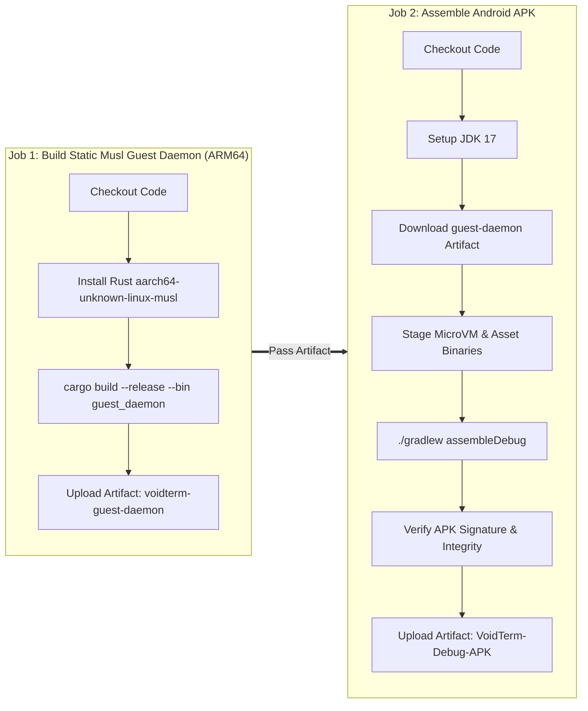

# VoidTerm: Production Build & Deployment Guide
## Comprehensive Guide for Compiling, Verifying, and Packaging Sovereign VoidTerm

**Status**: Active Production Guide  
**Target Platform**: Android 13–16 (`aarch64` / Bionic libc) | Target SDK 34+  
**CI/CD Pipeline**: GitHub Actions (`.github/workflows/build-apk.yml`) — Verified Passing (`✓`)

---

## 1. Prerequisites & Toolchain Setup

To build VoidTerm from source or reproduce the CI/CD pipeline locally:

- **Java Development Kit**: JDK 17 (Temurin or OpenJDK)
- **Android SDK & Build Tools**: Version $\ge 34.0.0$, Android Gradle Plugin 8.3+
- **Rust Toolchain**: Rust $\ge 1.75$ with static musl target:
  ```bash
  rustup target add aarch64-unknown-linux-musl
  ```
- **Python**: Python 3.10+ (for `voidpkg.py`, `void_ext_router.py`, and QA analyzer)
- **Gradle**: Gradle 8.6 (bundled via `./gradlew`)

---

## 2. GitHub Actions Automated CI/CD Pipeline

The canonical, production-grade build pipeline is fully automated in `.github/workflows/build-apk.yml`. Every commit to `main` executes a two-stage assembly matrix:



### Inspecting Workflow Status:
```bash
gh run list --repo polymath-void/voidterm-android-terminal-shell
gh run view <run_id> --repo polymath-void/voidterm-android-terminal-shell
```

### Downloading Pre-Built Artifacts:
```bash
gh run download <run_id> -n VoidTerm-Debug-APK
adb install -r app-debug.apk
```

---

## 3. Local Step-by-Step Compilation

### Step 1: Run Universal QA Static Analysis
Before compiling, verify that there are zero unmatched brackets, broken string templates, or syntax defects:
```bash
python3 ~/.gemini/config/skills/qa-analyzer/scripts/analyzer.py android/
```
Expected output:
```text
🚀 Running Universal QA Analyzer on: android/
✅ UNIVERSAL QA PASS: Structural integrity and syntax verified.
```

### Step 2: Compile Static Musl Guest Daemon (Rust)
```bash
cd hybrid-term-broker
cargo build --release --target aarch64-unknown-linux-musl --bin guest_daemon
cd ..

# Stage compiled binary into Android assets:
mkdir -p android/app/src/main/assets
cp hybrid-term-broker/target/aarch64-unknown-linux-musl/release/guest_daemon \
   android/app/src/main/assets/guest_daemon
```

### Step 3: Verify Core Assets Inventory
Ensure that the rootless POSIX bootstrap archive, package manager, and extension SDKs are present:
```bash
ls -lh android/app/src/main/assets/
# Required:
# - bootstrap-aarch64.zip (16.1 MB)
# - voidpkg.py
# - voidls.py
# - void_ext_router.py
# - extensions/ (/pkg, /file)
# - sdk/ (Python & Node.js)
```

### Step 4: Assemble Android Application APK
```bash
cd android

# Build Debug APK (no signing key required):
./gradlew assembleDebug

# Build Release APK (requires signing credentials):
./gradlew assembleRelease
```

The assembled APKs are generated at:
- **Debug**: `android/app/build/outputs/apk/debug/app-debug.apk`
- **Release**: `android/app/build/outputs/apk/release/app-release.apk`

---

## 4. End-to-End Subsystem Smoke Testing

Once installed on an Android device or emulator, execute the following verification commands inside VoidTerm:

### 1. Verify Unprivileged Hot-Reload:
```bash
void reload
# Expected output:
# [VoidTerm] Reload trigger written to filesystem.
# TerminalService logs: Hot-reloading DynamicCoreLoader.
```

### 2. Verify Package Manager & Dynamic Linker:
```bash
pkg doctor
# Expected output:
# [✔] Verifying prefix directory... PASS
# [✔] Verifying binary linkages... PASS
# [✔] Decompression engine check... PASS (ctypes preloaded)
```

### 3. Verify Polyglot Extensions & Concurrency:
```bash
void ext list
# Displays registered extensions with active PIDs

void ext run pkg
# Launches interactive ANSI package browser

# In another tab, attempting duplicate launch:
void ext run pkg
# Blocked: "Extension 'pkg' is already running with PID <pid>."
```

### 4. Verify Single & Master Panic Kill:
```bash
# Terminate single extension:
void ext kill pkg

# Terminate all running extensions (panic breaker):
void ext kill-all
```

### 5. Verify Virtual Keyboard Geometry:
- **Row 1**: Ends with **`▲`**.
- **Row 2**: Ends with **`◀`**, **`▼`**, **`▶`** directly beneath **`▲`**.
- Long press on keypad toggle allows dynamic budgeting or unlocked swipe gestures.

---

## 5. Google Play Store Release & Compliance Checklist

1. **Target SDK 34+ Invariant**: Verify `compileSdk = 34` and `targetSdk = 34` in `android/app/build.gradle.kts`.
2. **Foreground Service Special Use**: Ensure `FOREGROUND_SERVICE_SPECIAL_USE` has valid descriptions in `AndroidManifest.xml`.
3. **W^X Policy Compliance**: All host executable binaries are packaged within APK assets or mapped through Bionic-approved namespaces.
4. **App Bundle (.aab)**: For Google Play distribution:
   ```bash
   cd android
   ./gradlew bundleRelease
   ```
   The signed bundle is placed at `android/app/build/outputs/bundle/release/app-release.aab`.
